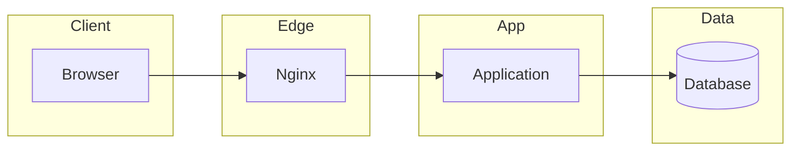
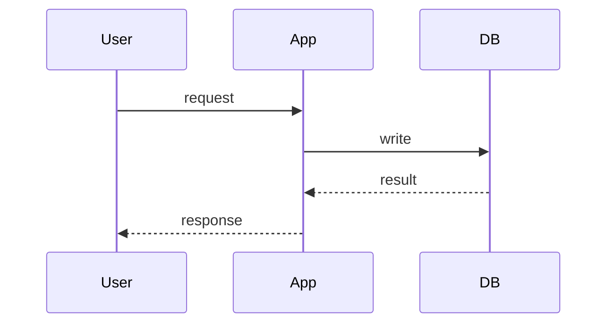
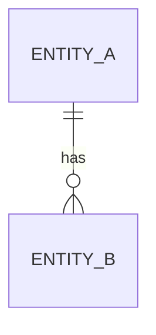

# System Design — {{feature}}

phase: 2
status: draft
slug: {{slug}}
created: {{date}}
approved_on: —

## Architecture



### Component responsibilities

| Component | Owns | Does not own |
|---|---|---|
| | | |

### Primary flow



### Data flow — Level 0

```mermaid
flowchart LR
  U[User] -->|request| S(({{system}}))
  S -->|response| U
  X[External service] -->|callback| S
  S -->|outbound| X
```

### Data flow — Level 1

```mermaid
flowchart LR
  U[User] -->|input| P1[1.0 Validate]
  P1 -->|lookup| D1[(D1 {{store}})]
  P1 -->|valid| P2[2.0 Persist]
  P2 -->|write| D2[(D2 {{store}})]
  P2 -->|result| U
```

| # | Flow | From → To | Data | Trigger | Mode |
|---|---|---|---|---|---|
| | | | | | sync / async |

### Sync vs async

| Operation | Mode | Why | Failure behaviour |
|---|---|---|---|
| | | | |

### Deployment topology

- 

### Deliberately not built

- 

## Database schema



### Entity tables

#### `entity_a`

| Field | Type | Null | Default | Constraint / index |
|---|---|---|---|---|
| id | bigint unsigned | no | auto | PK |
| created_at | timestamp | yes | null | idx |

### Relationships and cascade policy

| Parent | Child | On delete | Reason |
|---|---|---|---|
| | | | |

### Migration plan

| # | Migration | Reversible | Notes |
|---|---|---|---|
| 1 | | yes | |

### Conventions

- Primary keys:
- Timestamps / timezone:
- Money:
- Soft deletes:
- Tenancy:
- JSON casing:

## API contracts

| Method | Path | Authn | Authorization | Request | Success | Failures |
|---|---|---|---|---|---|---|
| | | | | | | |

### Request / response examples

```
POST /api/v1/...
```
```json
{}
```
```json
{}
```

### Error envelope

```json
{ "error": { "code": "", "message": "", "details": {} } }
```

### Pagination and filtering

- Style:
- Default / max page size:
- Allowed filters:
- Allowed sorts:

### Cross-cutting rules

- Idempotency:
- Versioning:
- Rate limits:
- Webhooks (signature, replay window, retries):

## Security notes

- 

## Rollout and rollback

- 

## Requirement traceability

| Requirement | Entity | Endpoint |
|---|---|---|
| FR-1 | | |

## Project documentation outputs

| File | Action |
|---|---|
| docs/architecture.md | created / updated — flowchart, DFD L0+L1, ERD |
| docs/deployment.md | created / seeded |
| docs/README.md | created / unchanged |
