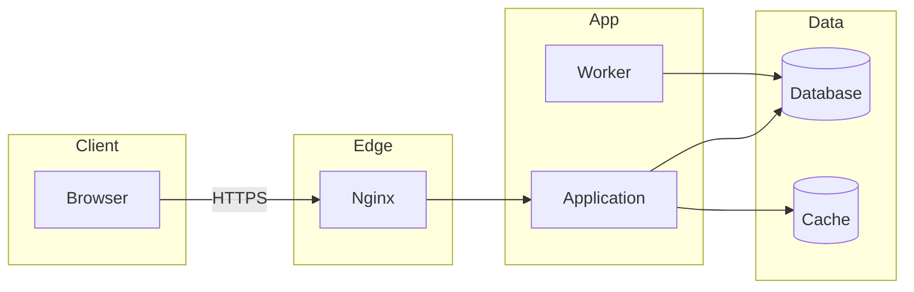
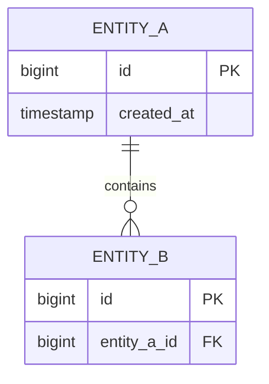

# Architecture — {{project_name}}

owner: {{owner}}
status: draft
version: 0.1
last_updated: {{date}}
related: [deployment.md, sdlc/{{slug}}/02-design.md]

> Required diagrams: component flowchart, data flow diagram (Level 0 and Level 1), ERD.
> All diagrams Mermaid, renderable on GitHub. See `references/documentation-standards.md`.

## 1. System context

{{one paragraph: what this system does, who uses it, what it depends on}}

### Data flow — Level 0

```mermaid
flowchart LR
  U[User] -->|request| S(({{system}}))
  S -->|response| U
  E[External service] -->|callback| S
  S -->|outbound call| E
```

## 2. Components



| Component | Responsibility | Does not own |
|---|---|---|
| | | |

## 3. Data flow — Level 1

```mermaid
flowchart LR
  U[User] -->|input| P1[1.0 Validate]
  P1 -->|lookup| D1[(D1 {{store}})]
  P1 -->|validated| P2[2.0 Persist]
  P2 -->|write| D2[(D2 {{store}})]
  P2 -->|result| U
```

| # | Flow | From → To | Data | Trigger | Mode |
|---|---|---|---|---|---|
| | | | | | sync / async |

## 4. Data model



### Data dictionary

| Entity | Field | Type | Null | Notes |
|---|---|---|---|---|
| | | | | |

> If this exceeds ~12 entities, move the ERD and dictionary to `docs/data-model.md` and link it here.

## 5. Cross-cutting concerns

- **Authentication:**
- **Authorization model:** (role / policy / per-record; where it is enforced)
- **Logging and audit:**
- **Error handling:**
- **Money and time:** (minor units, UTC storage, display timezone)
- **Caching:**
- **i18n:**

## 6. Non-functional targets

| Concern | Target |
|---|---|
| Volume | |
| Latency | |
| Availability | |
| Retention | |

## 7. Architecture decisions (ADR log)

| Date | Decision | Alternatives rejected | Why |
|---|---|---|---|
| {{date}} | | | |

## 8. Known limitations

- 
