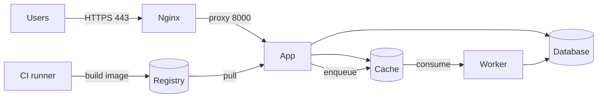

# Deployment — {{project_name}}

owner: {{owner}}
status: draft
version: 0.1
last_updated: {{date}}
related: [architecture.md]

## 1. Environments

| Name | URL | Purpose | Data | Who deploys |
|---|---|---|---|---|
| local | http://localhost | Development | synthetic | any developer |
| staging | | Pre-release verification | anonymised | |
| production | | Live | real | |

## 2. Topology



## 3. Services and ports

| Service | Image / runtime | Internal port | Exposed | Healthcheck |
|---|---|---|---|---|
| nginx | | 80/443 | yes | |
| app | | 8000 | no | |
| worker | | — | no | |
| db | | 5432 | no | |

## 4. Configuration and secrets

| Variable | Source | Rotation | Notes |
|---|---|---|---|
| | | | |

- Secrets are never committed. `.env.example` documents keys only.

## 5. Build and release

| Stage | Command | Artifact | Fails when |
|---|---|---|---|
| Lint | | — | any diff |
| Static analysis | | — | any error |
| Tests | | — | any failure |
| Build | | image | build error |
| Dependency audit | | — | High or above |
| Container scan | | — | fixable critical |
| Deploy | | — | healthcheck fails |

Release strategy: {{rolling / recreate / blue-green}}. Downtime expectation:

## 6. Migrations

- Run by: {{release step / manual / job}}
- Order:
- Backup before migrate: yes / no
- Rollback: {{down migration / forward fix}}

## 7. Backup and restore

| Item | Schedule | Retention | RPO | RTO |
|---|---|---|---|---|
| Database | | | | |
| Uploads | | | | |

Last tested restore: {{date or "never"}}
Restore procedure: see runbook §10.

## 8. Monitoring and alerting

| Signal | Threshold | Destination |
|---|---|---|
| HTTP 5xx rate | | |
| Queue depth | | |
| Disk usage | | |
| Backup failure | | |

## 9. Runbook

**Deploy**

```
{{commands}}
```

**Roll back**

```
{{commands}}
```

**Restore database**

```
{{commands}}
```

**Rotate a secret**

```
{{commands}}
```

**Scale up**

```
{{commands}}
```

**Failed migration**

```
{{commands}}
```

## 10. Known risks

- 
