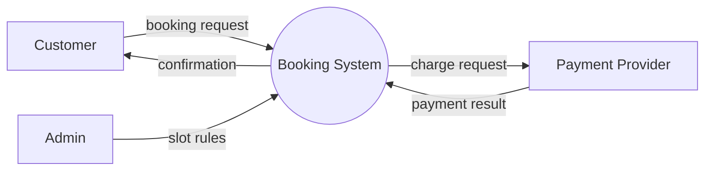
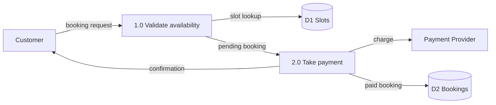

# Documentation Standards

Read before writing or updating `docs/architecture.md`, `docs/deployment.md`, `docs/README.md`, or any diagram in a phase document.

## Three diagrams, three jobs

Most designs collapse these into one flowchart and call it documentation. Do not.

| Diagram | Answers | Never contains |
|---|---|---|
| **Flowchart / component diagram** | What are the parts and how do they call each other? | Data names, storage detail, step-by-step ordering |
| **Data flow diagram (DFD)** | What data enters, where it is stored, what transforms it, where it leaves? | Control flow, branching logic, technology choices |
| **ERD** | What entities exist, their attributes, keys, and cardinality? | Processes, UI, request ordering |

A DFD with no data store, or a flowchart with labeled data payloads, means you drew the wrong one.

## Mermaid rules

- Fenced block, `mermaid` info string. Must render on GitHub without plugins.
- Node labels in plain language a new hire understands — not class names.
- Label every edge that carries data or triggers a process. An unlabeled arrow in a DFD is a defect.
- One diagram per concern. Four diagrams across two files beats one diagram with 60 nodes.
- Direction: `flowchart LR` for component and context views, `flowchart TB` for hierarchy.
- Subgraphs for trust boundaries only, and name them (`Edge`, `App`, `Data`, `ThirdParty`).
- ERDs via `erDiagram`; state cardinality (`||--o{`). Do not hand-draw tables as flowchart nodes.

## DFD levels

**Level 0 (context)** — exactly one process box (the system), the external entities that interact with it, and the data flows between them. No internal stores. Roughly 5 boxes.

**Level 1** — decompose the single process into numbered processes (`1.0`, `2.0`, …), add data stores, and keep the external entities. Every process has at least one input and one output. Every store is labeled `D1`, `D2`, and matches a table or bucket in the ERD.

Level 2 only when a single process is genuinely too complex to review. Do not decompose the whole system to Level 2.

## architecture.md contents

Required sections, in order:

1. **Status** — owner, last updated, version.
2. **System context** — one paragraph plus the Level 0 DFD.
3. **Components** — flowchart with trust boundaries, then a table: component → responsibility → does not own.
4. **Data flow** — Level 1 DFD, plus a short table of flows: source → destination → data → trigger → sync/async.
5. **Data model** — ERD plus a data dictionary table (entity, field, type, null, notes). Link to `data-model.md` if split out.
6. **Cross-cutting concerns** — authn, authz model, logging and audit, error handling, money and time handling, i18n, caching.
7. **Non-functional targets** — volume, latency, availability, retention.
8. **Decisions (ADR log)** — table: date, decision, alternatives rejected, why. Append-only; never rewrite history.
9. **Known limitations** — what this design deliberately does not solve.

## deployment.md contents

Required sections, in order:

1. **Status** — owner, last updated, current released version.
2. **Environments** — table: name, URL, purpose, data policy (real/anonymised/synthetic), who can deploy.
3. **Topology** — flowchart: edge, app, worker, database, cache, object storage, external services, CI runner. Show what talks to what and over which protocol.
4. **Services and ports** — table: service, image/runtime, internal port, exposed port, healthcheck.
5. **Configuration and secrets** — where each comes from (env file, secret manager, CI variable), and rotation policy.
6. **Build and release** — pipeline stages with the actual command per stage, and the artifact produced.
7. **Migrations** — how they run, in what order, who triggers them, and the rollback or forward-fix procedure.
8. **Backup and restore** — schedule, retention, RPO/RTO, and the last time a restore was actually tested.
9. **Monitoring and alerting** — signal, threshold, destination.
10. **Runbook** — deploy, roll back, restore, rotate a secret, scale up, respond to a failed migration.
11. **Known risks** — single points of failure, manual steps, anything that would hurt at 3am.

## Freshness rules

Docs are part of the definition of done. These changes force an update:

| Change | Update |
|---|---|
| New entity or column | ERD + data dictionary + migration section |
| New component, service, or queue | Component flowchart + services table + ADR |
| New external integration | Context DFD + data flow table + secrets section |
| New endpoint class or auth boundary | Cross-cutting concerns + API contract in the phase doc |
| New environment, pipeline stage, or infra resource | `deployment.md` topology, pipeline, runbook |
| Changed backup/retention policy | `deployment.md` backup section |
| Any gate printed, approved, revised, or bypassed | `journey.html` new entry |
| Any earlier decision changed after approval | `journey.html` `revision` entry with `revises` set |
| Implementation batch completed | `journey.html` `build` entry |

If code and docs disagree, the docs are wrong until proven otherwise — fix them in the same change, not later.

## Development journey rules

`docs/journey.html` is the narrative record, not a commit log. It answers "what did we decide, when, and what changed afterwards".

- **Append-only.** History is never rewritten. Corrections are new entries that point back via `revises`.
- **Start from zero.** The first entry is the project start. If the file is created late, backfill the earlier gates from `STATE.md` and the phase documents before adding new entries — a timeline that starts mid-project is misleading.
- **Revisions are first-class.** When a gate is revised, add a `revision` entry naming what changed and why. When a shipped feature is later altered, add a `revision` entry linked to the original build entry, so the pair reads as before/after.
- **One entry per meaningful event.** Not per file edited. A batch of six files is one `build` entry listing all six.
- **Summary is for the reader, not the diff.** State the decision and its consequence: "Switched bookings from soft deletes to hard deletes; audit now relies on the event log."
- **Edit the JSON block only.** The renderer and styles are shared across projects; per-project restyling destroys that.

## Review checklist

Before any gate that produces or updates these files:

1. Every diagram renders — mentally parse the Mermaid; no unclosed subgraph, no stray quotes in labels.
2. Flowchart, DFD, and ERD all exist and are distinct.
3. Every node in the DFD maps to a component in the flowchart or a store in the ERD.
4. Every ERD entity appears in the data dictionary.
5. Every environment in `deployment.md` matches what actually exists.
6. Every command in the pipeline section was run at least once, or is marked `proposed`.
7. ADR log has an entry for every decision the gate is asking to lock.
8. `docs/README.md` links every file in the set, with a one-line purpose each.
9. `docs/journey.html` has an entry for this gate, and any revised decision points at the entry it supersedes.

## docs/README.md

Keep it short: what documentation exists, which file answers which question, and the one rule that matters — update the doc in the same change as the code.
