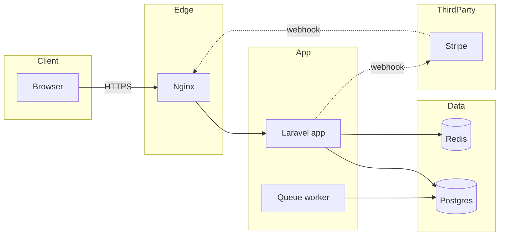

# Phase 2 — System Design & Schema

Goal: a design specific enough that Phase 3 is mechanical. Three artifacts, in this order: architecture, schema, API contracts. No application code.

## 1. Architecture and data flow

Required content:
- Mermaid `flowchart LR` of components, with trust boundaries drawn as subgraphs: `Client`, `Edge`, `App`, `Worker`, `Data`, `ThirdParty`.
- Mermaid `sequenceDiagram` of the single most important flow, including failure branches.
- **DFD Level 0** — the system as one process, external entities, labeled inbound and outbound data flows.
- **DFD Level 1** — numbered processes (`1.0`, `2.0`, …), data stores (`D1`, `D2`, …), one input and one output per process, every edge labeled with the data it carries.
- A flow table: source → destination → data → trigger → sync/async.
- Synchronous vs queued: name every operation that leaves the request cycle, and why.
- State ownership: which component is the source of truth for each entity.
- Deployment topology: containers, reverse proxy, volumes, how workers are reached, where env/secrets land.
- One short paragraph on what you deliberately did **not** build (no message bus for 200 events/day).

Template:



## 2. Schema conventions

Default to these unless the repo already does otherwise; if you deviate, say why in one line.

| Concern | Convention |
|---|---|
| Table names | `snake_case`, plural (`booking_slots`) |
| Primary key | `bigint unsigned` auto-increment; `uuid`/`ulid` only if IDs are exposed publicly or generated offline |
| Timestamps | `created_at`, `updated_at` in UTC; `deleted_at` only where soft delete is a requirement |
| Money | integer minor units + `char(3)` currency; never float |
| Enums | string column + check constraint, or a lookup table if values are user-managed |
| Booleans | `is_` / `has_` prefix, non-null with default |
| FK | every FK indexed; cascade policy stated per relationship |
| Cascade policy | `RESTRICT` for financial/audit records; `CASCADE` only for owned children with no independent meaning |
| Unique constraints | natural keys (email, slug) plus `(tenant_id, external_id)` style idempotency keys |
| Indexes | one per FK, one per filter/sort column used by a listed endpoint, composite in filter-then-sort order |
| Tenancy | `tenant_id` on every tenant-scoped table, included in every unique index |
| Naming of API-facing fields | `snake_case` internally; state the JSON casing explicitly (`snake_case` vs `camelCase`) |

Required output per entity: a field table (name, type, null, default, constraint, index) and the relationship line in the ERD. A prose description without types is not a schema.

Migration plan: ordered list, one line each, with the rollback story (down migration, data backfill, or irreversible — flagged).

## 3. API contracts

One table per endpoint:

| Method | Path | Authn | Authorization | Request | Success | Failures |
|---|---|---|---|---|---|---|
| POST | `/api/v1/bookings` | session | `BookingPolicy@create` | `{slot_id, idempotency_key}` | `201 Booking` | 401, 403, 409 slot taken, 422 validation |

Then, for every endpoint that writes: a request JSON example and a response JSON example. For every list endpoint: pagination style, default and max page size, allowed filters and sorts, and the response envelope.

Shared error envelope — pick one and apply it everywhere:

```json
{ "error": { "code": "slot_unavailable", "message": "That slot was just taken.", "details": { "slot_id": 42 } } }
```

State explicitly:
- **Authn mechanism** (session cookie + CSRF, Sanctum token, JWT) and where it is enforced.
- **Authorization unit** — role, policy, or gate — and which layer enforces it.
- **Idempotency** — header or body key, storage, retention window.
- **Versioning** — `/api/v1/` or header; what counts as a breaking change.
- **Rate limits** per endpoint class.
- **Webhook contracts** if third parties call in: signature verification, replay window, retry semantics.

## Where contracts live per stack

| Stack | Contract home |
|---|---|
| Laravel + Livewire | `routes/web.php` for page actions, Livewire component actions for mutations, `routes/api.php` for anything external. Policies in `app/Policies`. |
| Laravel API + SvelteKit | Laravel `routes/api.php` is the contract; SvelteKit `+page.server.ts` load/actions consume it. State that server-side fetch never forwards raw tokens to the browser. |
| SvelteKit only | `+page.server.ts` / `+server.ts` endpoints with typed `RequestHandler`; form actions for mutations. |
| Express | Router per resource, request validation at the router boundary, error middleware returning the shared envelope. |
| React + API | Client contract lives in the API layer; state the fetch/query wrapper and where auth headers attach. |

## 4. Project documentation outputs

Design work is not finished when the feature document is written. Phase 2 also produces or updates the project-level docs; read `references/documentation-standards.md` first.

| File | Action |
|---|---|
| `docs/architecture.md` | Create from `assets/templates/architecture.md` (new project) or update in place (existing project) |
| `docs/deployment.md` | Create from `assets/templates/deployment.md`, seeded with environments, topology, services, config, and pipeline |
| `docs/README.md` | Create only if the repo has no documentation index |

Rules:

- Three diagrams minimum in `architecture.md`: component flowchart, DFD Level 0 + Level 1, ERD. Distinct diagrams — see the standards file.
- Updating an existing `architecture.md` means *adding*, not rewriting: extend the flowchart, add the new flows to the DFD, add entities to the ERD, append a dated ADR row. Never regenerate the file in a way that drops previously documented components.
- Anything in `deployment.md` you cannot yet verify (monitoring, restore drill, runbook) is written as `proposed` and completed in Phase 4 — not omitted.
- List every file produced in the gate 2 card.

## Self-review before gate 2

Run every check; fix before writing the document.

1. Every `FR-n` in `01-requirements.md` maps to at least one entity or endpoint. List the mapping at the end of `02-design.md`.
2. `docs/architecture.md` contains a flowchart, a Level 0 DFD, a Level 1 DFD, and an ERD, and the ERD matches the entity tables.
3. Every node in the Level 1 DFD maps to a component in the flowchart or a store in the ERD.
4. `docs/deployment.md` exists, and every environment it lists is one you can actually name.
5. Every endpoint has an authorization rule — not just "auth required".
6. Every FK has an index. Every filter/sort used by a list endpoint has an index.
7. Every list endpoint paginates, with a max page size.
8. No float money. No local-time storage. No nullable boolean.
9. Every state transition is either an endpoint or explicitly forbidden.
10. Every third-party call has a timeout, a retry decision, and a failure behaviour.
11. Nothing in the design requires a table you have not defined.
12. The ERD and the entity field tables agree — same names, same nullability.

## Document

Write `docs/sdlc/<slug>/02-design.md` using `assets/templates/02-design.md`, then print the gate 2 card. Nothing after it.
